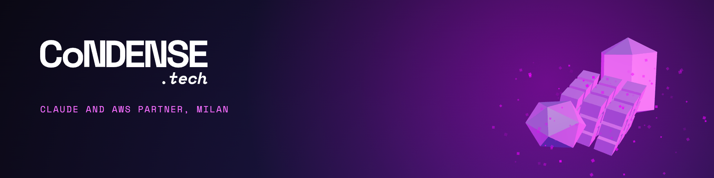

<picture>
  <source media="(prefers-reduced-motion: reduce)" srcset="header.png">
  
</picture>
 

We build and operate AI agents, cloud-native applications, and the platforms behind them. We are a software engineering team based in Milan, Italy, working across agentic engineering, AWS, and platform engineering.

Our work spans tool integration and agent evaluation, infrastructure as code, delivery pipelines, observability, and production operations. Engineers own the architecture and the decisions, including when agents should act and when people should review.

## Explore the code

These repositories share reusable tools and implementation examples from our work.

### AI agents and tools

- [Clockify MCP server](https://github.com/condensetech/clockify-mcp-server), a local MCP server for logging and managing time entries, with timezone handling and explicit tool schemas.
- [Hermes on Amazon Bedrock AgentCore](https://github.com/condensetech/bedrock-hermes-agent), our extension of an AWS sample, adding integrations, recurring tasks, and operational instrumentation. An experimental deployment example to inspect and adapt.

### AWS and platform engineering

- [ECR scan alerts](https://github.com/condensetech/cdk-ecr-scan-alert), a CDK construct that checks container image vulnerabilities during deployment, reports findings to GitHub, and can block deployment by severity.
- [CDK constructs](https://github.com/condensetech/cdk-constructs), reusable infrastructure for networking, databases, shared load balancers, and CloudWatch monitoring.

### Application delivery and integration

- [DirectusPT](https://github.com/condensetech/directuspt), an unmaintained CLI for snapshotting and applying Directus schema, permissions, folders, and translations. Retained as a historical example of a Git-based workflow.
- [Medusa admin SSO example](https://github.com/condensetech/medusajs-sso-admin-example), a worked example of Google SSO integration for the Medusa admin dashboard.

Check each repository for setup instructions, dependencies, and limitations. Forks retain their upstream attribution.

## Engineering in context

- [Agent deployment architecture](https://github.com/condensetech/bedrock-hermes-agent/blob/main/docs/ARCHITECTURE.md), components and request flow for the Hermes deployment.
- [Erga Tourism](https://condense.tech/customers/erga-tourism), a production Claude agent connected to booking tools, evaluated against real conversations and purchase flows.
- [Attorney Share](https://condense.tech/customers/attorneyshare), AWS infrastructure as code and environments created for individual pull requests.

AWS Advanced Tier Services Partner and Select Services Partner in the Claude Partner Network.

[Website](https://condense.tech)&emsp;[Customer stories](https://condense.tech/customers)&emsp;[LinkedIn](https://www.linkedin.com/company/condensetech/)&emsp;[Contact](mailto:info@condense.tech)
